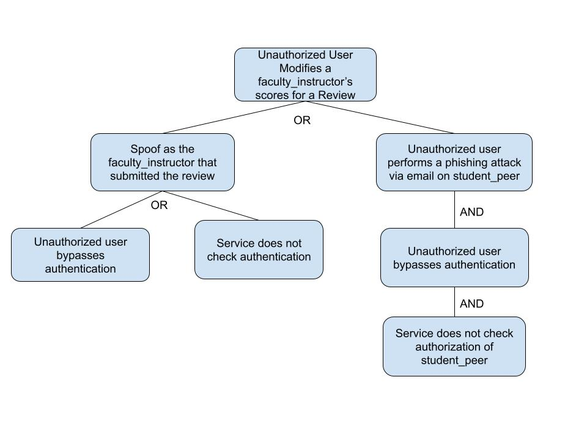
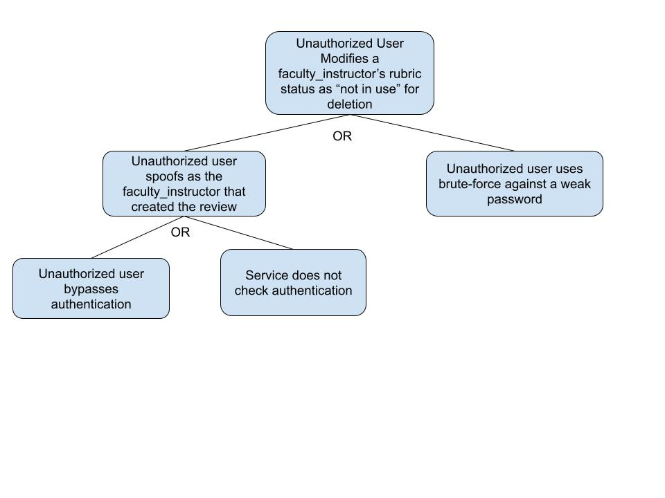
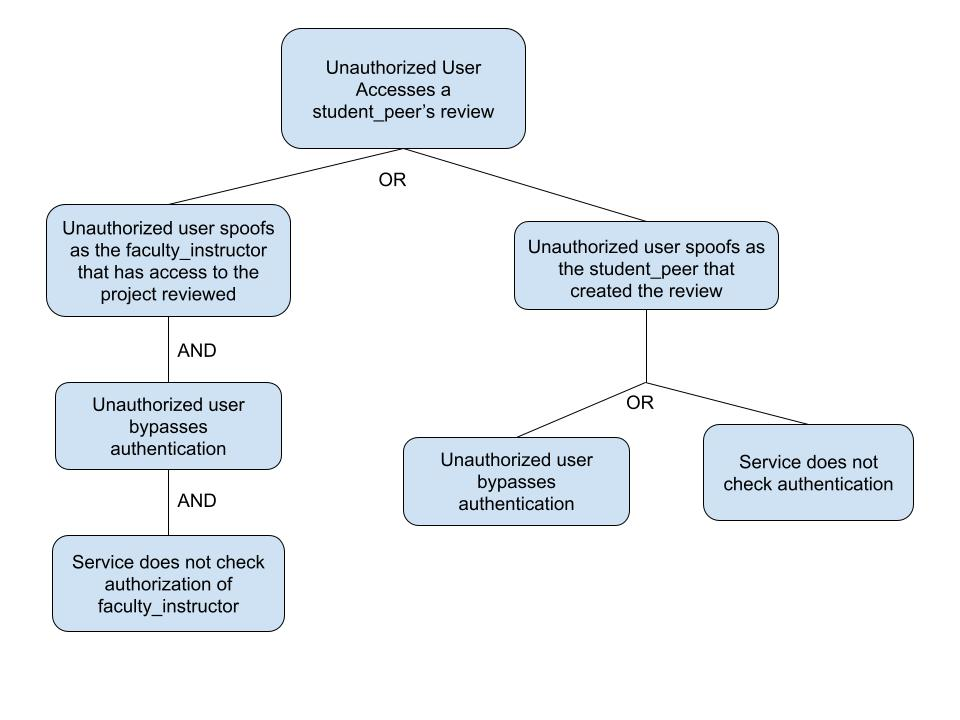

# Security Analysis

## AI Usage Log
| AI Contribution % | Summary of prompt                                             |
| :---------------: | ------------------------------------------------------------- |
|        10%        | Different types of mitigation strategies used in the industry and examples of the type of information that should be included for security requirements. |

### Security Requirements
### Authentication
* The system will validate that only existing users can log in

### Authorization
* The system will validate that only faculty_instructors are able to create rubrics
* The system will validate that only valid faculty_instructors and student_peers are able to create, edit, and delete evaluations they have made/own
* The system will validate that only faculty_instructors are able to create rubrics and criterion for said rubrics.
* The system will validate that only faculty_instructors are able to generate reports for a project
* The system will validate that faculty_instructors see student_peer evaluations only as anonymous

### Input Validation
* The system will validate that any feedback not contain any special characters
* The system will validate that project IDs, review IDs, criterion IDs exist
* The system will validate that scores are >=0 and < max score
* The system will validate that the sum of weights for criterions of the same rubric are <= 1
* The system will validate that only rubrics not in use can be deleted or edited
* The system will validate that each project is associated with exactly one rubric
* The system will validate that the review_id exists

### Error Handling
* The system will handle a faculty_instructor attempting to delete or edit a rubric that is in use by providing an error message stating so
* The system will handle a project not having a rubric by providing the faculty_instructor an error message stating so
* The system will handle retrieving an evaluation with an invalid review_id by providing a message stating the evaluation could not be found

### Functional Security Requirements

#### Submitting an Evaluation
As a student reviewer, I want to submit an evaluation that remains anonymous, so that I can review a project. 

Acceptance Criteria
* The evaluation form has asteriks for required fields
* The system validates all required fields have content
* When attempting to submit an evaluation with empty required fields, the system provides an error message that "all required filled must be filled"
* Upon a successful submitted evaluation the system provides a success message
* On a failed submission attempt, other than empty fields, the system provides an error message without revealing specific details
* Reviewer type is listed as a student, but no identifying informatin is further associated

#### Creating a Rubric
As a faculty/instructor, I want to create a rubric, so that a project can have a rubric

Acceptance Criteria
* The text fields for name, description, and criteria's required fields are filled
* The project now is associated with exactly one rubric. The one just created.

#### Generating a Report
As a faculty/instructor, I want to generate a report of projects for a course/ research lab, so that I can review the statistics of all project evaluations in that course/research lab 

Acceptance Criteria
* The report includes a mean score, standard deviation, and weighted grade of each project's
* The report generates the statistics when the faculty/instructor triggers the API call

### Non-Functional Security Requirements
#### Submitting Reviews
System must allow up to 500 student_peers/ faculty_instructors to submit a review at a time

#### Generating Report
System must generate reports within 30 seconds

#### Modifications
System must make modifications for evaluations, criterions, and rubrics within 5 second.

### CIA
Confidentiality
* An evaluation can only be viewed by its owner or the faculty_instructor for the course
* Owners of a project cannot see which student_peers evaluated their work
* An evaluator can only view the project they are evaluating

Integrity
* An evaluation can only be modified or deleted by its creator
* A report can only be generated by a faculty_instructor
* A rubric can only be modified by a faculty_instructor when it is not in use

Availability
* All faculty_instructors can access reports for the specific course/lab they teach
* All faculty_instructors can access the list of evaluations for the specific course/lab they teach

## Abuse Cases
* As an attacker, I want to edit a faculty_instructor's review, so that I can score a review they made as lower than they submitted.
* As an attacker, I want to download a report of a projects reviews, so that I can have the projects statistics.
* As an attacker, I want to access a review a student made, so that I can expose the scores they made.
* As an attacker, I want to edit the rubric, so that I can change the status as not in use for deletion.
* As an attacker, I want to edit the criteria max scores as higher, so that the review scores will appear as graded lower for a project.

## Attack Trees (3)
#### As an attacker, I want to edit a faculty_instructor's review, so that I can score a review they made as lower than they submitted.

#### As an attacker, I want to edit the rubric, so that I can change the status as not in use for deletion.

#### As an attacker, I want to access a review a student made, so that I can expose the scores they made.

## Attack Surface Mapping
* All resource
    * HTTP headers and cookies
        * Responses
        * Requests
    * Application specific (Vector with highest)
        * /rubrics
        * /rubrics/{rubric_id}
        * /projects/{project_id}/summary 
        * /projects/{project_id}/reviews
        * /projects/{project_id}/reviews/{reviews_id}
        * /reports 

    * Files
        * 'evaluation-report.json' from /reports

## STRIDE Threat Modeling
### Security Requirements
* The system will check the authentication of users
* The system will validate an existing student_peer can only create and edit their reviews
* The system will validate that a student_peer review appears as anonymous in reports
* The system will validate an existing faculty_instructor can only create, edit, delete, get reviews from their course, lab, project
* The system will validate an existing faculty_instructor can create a report summary of their course, lab, project
* The system will validate that reviews and project summaries are only available to faculty_instructors

### DFD

### STRIDE Matrix
| Data Flow/ Boundary/ Component | STRIDE Type Applicable                         |
| ------------------------------ | ---------------------------------------------- |
| Review Data                    | Tampering, Repudiation, Information Disclosure |
| Projects Data                  | Spoofing, Information Disclosure               |
| Criterion Data                 | Tampering                                      |
| Rubric Data                    | Tampering, Repudiation                         |
| Web Client                     | Spoofing                                       |
| Web Server                     | Spoofing                                       |

## Proposed Mitigations
In terms of security concerns with authentication of users, incorporating the use of 
sessions that last for a specific amount of time before they are expired would be beneficial. 
Before a user can commit any action, be that editing, deleting, or creating a review in the 
case of a student_peers and faculty_instructors, or creating rubrics, project 
summaries/reports for faculty_instructors it is important tp confirm users have the correct 
permissions for their desired actions. As such every time an API call is made, the authorization 
of the user making the call would need to be authenticated first. Similarly, every time 
an API call is made, the call and the user attempting the call would be added to a log 
for audit and accountability purposes. This would help deter users from attempting to access
 information they should not. 
As for the information being passed for the API calls, it would be imperative to validate 
the information being passed like IDs, feedback, and scores. It would further be 
beneficiary to implement the appropriate error handling. This would help solve concerns 
of missuing the service. In a similar vein, it would be important to add rate and request size limits 
in order to prevent the service from being overloaded and consistently monitoring the health of the API 
for resilience purposes. It would further be important to frequently scan the project with SonarQube, 
Semgrep, or any of the other dependencies and update any vulnerabilities found.